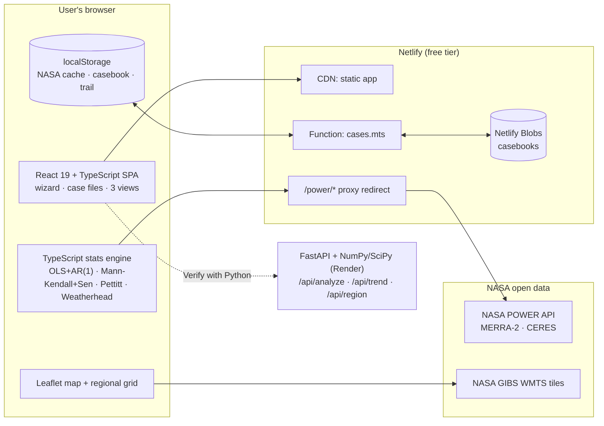
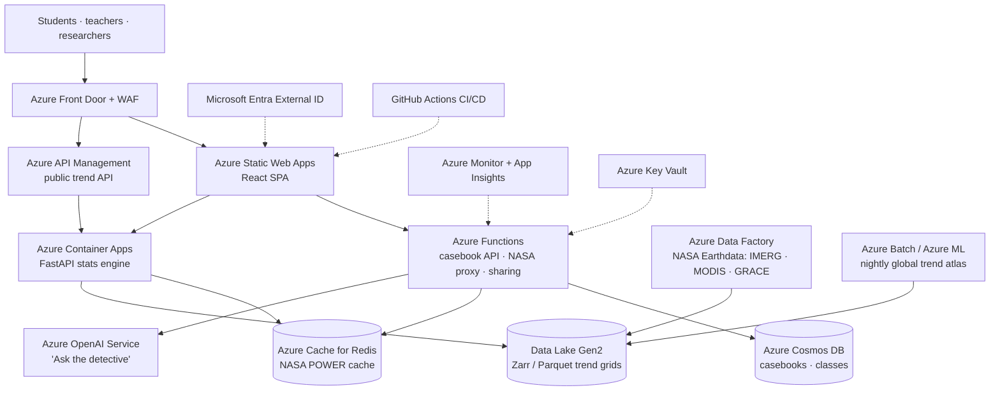

# Trend Detective: architecture

## 1. Current architecture (hackathon build, $0 to run)

| Piece | Where | Why |
|---|---|---|
| UI and statistics | Browser | No server cost; the app keeps working if the backend sleeps |
| NASA data | NASA POWER via the `/power/*` proxy (direct call as fallback) | Avoids CORS issues; responses are cached in `localStorage` |
| Basemap | NASA GIBS tiles + Esri labels | Free, no API key |
| Casebook sync | `/.netlify/functions/cases?book=CODE` → Netlify Blobs | Free, no database to manage |
| Local dev | The same endpoint, served by Vite middleware into `frontend/.data/casebooks/*.json` | Works without Netlify CLI |
| Verification | FastAPI + SciPy, unit-tested against `scipy.stats` | Independent second engine; the results agree to about 1e-15 |

## 2. Future architecture on Microsoft Azure

| Layer | Service | Role |
|---|---|---|
| Edge | Azure Front Door + WAF | Global CDN, TLS, bot and DDoS protection |
| Identity | Microsoft Entra External ID | Student and teacher sign-in, classrooms, shared case files |
| API | Azure API Management | Rate-limited public trend API for schools and researchers |
| Frontend | Azure Static Web Apps | Hosts the React app, with a preview environment per pull request |
| Serverless API | Azure Functions | Casebook CRUD, NASA proxy, share links |
| Stats engine | Azure Container Apps | FastAPI/SciPy service that scales to zero |
| Database | Azure Cosmos DB | Casebooks, classes, shared cases (partitioned by user) |
| Cache | Azure Cache for Redis | Hot cache of NASA POWER responses, so NASA gets fewer calls |
| Data lake | Azure Data Lake Storage Gen2 | Precomputed global trend grids in Zarr or Parquet |
| Ingestion | Azure Data Factory | Brings in more NASA Earthdata: GPM IMERG, MODIS NDVI, GRACE |
| Batch / ML | Azure Batch / Azure Machine Learning | Nightly global trend atlas and forecasting experiments |
| AI | Azure OpenAI Service | Plain-language "Ask the detective" explanations of the results |
| Ops | Azure Monitor, Application Insights, Key Vault | Tracing, alerts, secrets, managed identity |
| Delivery | GitHub Actions | Runs both test suites (TypeScript and Python), then deploys |

**Migration path (no rewrite):**
- Netlify Blobs → Cosmos DB
- Netlify Function → Azure Functions, with the same `cases` endpoint and JSON
- Render → Container Apps, with the same FastAPI image
- Netlify CDN → Static Web Apps + Front Door
